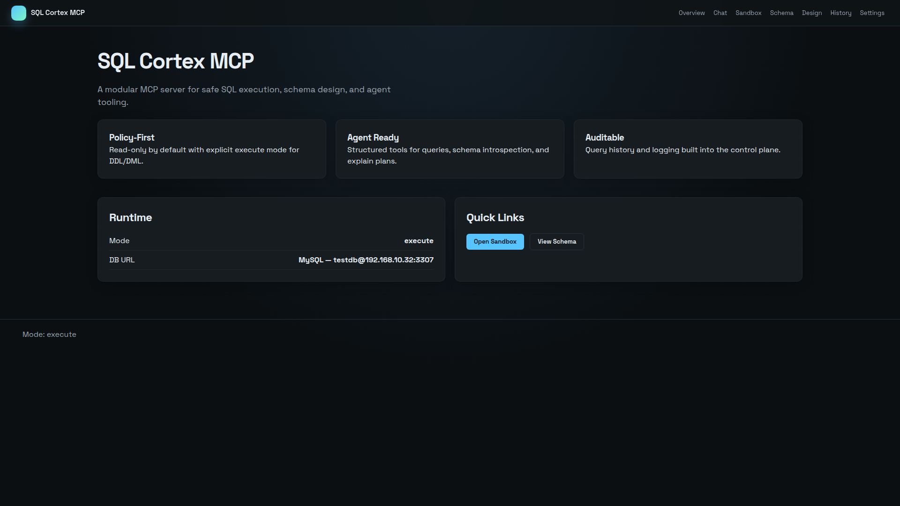

# SQL Cortex MCP

MCP server that exposes SQL databases to AI agents (Claude, OpenAI, Gemini, and other MCP clients) with policy enforcement, schema tools, and an optional admin UI.

## Overview

SQL Cortex MCP implements the [Model Context Protocol](https://modelcontextprotocol.io) over HTTP/JSON-RPC. It sits between an LLM client and your database, enforcing read-only or execute modes, row limits, and query timeouts while providing tools for schema introspection, EXPLAIN plans, and controlled migrations.

The stack is **Python 3.12+**, **FastAPI**, **SQLAlchemy**, and **Jinja2/HTMX** for the web UI. Settings and encrypted API keys persist in a local SQLite store under `./data/`.

## Features

- **11 MCP tools** — `sql.query`, `sql.schema`, `sql.explain`, `db.list`, `db.use`, design/migration helpers, and mutating `db.apply` / `db.migrate` when mode allows
- **Multi-database** — register connections in the admin UI; per-session switching via `db.list` / `db.use`
- **Policy layer** — read-only vs execute, statement allowlists, default row limits, query timeouts
- **Admin UI** — dashboard, SQL sandbox, schema browser, chat assistant, query audit log, settings
- **Multi-provider LLM** — OpenAI-compatible APIs, Anthropic Messages API, and Ollama for in-app chat
- **Docker** — single-service compose file with persisted `./data` volume

## Tech stack

| Layer | Technology |
| --- | --- |
| Runtime | Python 3.12+ |
| API / MCP | FastAPI, Uvicorn |
| Database access | SQLAlchemy 2.x |
| Drivers | SQLite (built-in), PyMySQL, psycopg2-binary |
| UI | Jinja2 templates, HTMX, static CSS |
| HTTP client (LLM) | httpx |
| Secrets at rest | cryptography (Fernet) |

## Prerequisites

- **Python 3.12+** for local development
- **Docker** and **Docker Compose** (optional, recommended for quick start)
- **Node.js 24+** and **npm** (only for CSS/template lint in CI or local `Makefile` targets)
- A SQL database URL (SQLite file is the default; MySQL/PostgreSQL supported)

## Getting started

### Clone

```bash
git clone https://github.com/vonmiller1/sql-cortexs.git
cd sql-cortexs
```

### Environment

Copy the example file and adjust non-secret values:

```bash
cp .env.example .env
```

Key variables (names only — do not commit real secrets):

| Variable | Purpose |
| --- | --- |
| `DB_URL` | SQLAlchemy connection URL |
| `MODE` | `read-only` or `execute` |
| `LIMIT_DEFAULT` | Max rows returned by read queries (0 = no cap) |
| `TIMEOUT_MS` | Query timeout in milliseconds |
| `ENABLE_UI` | Enable `/` admin routes |
| `ALLOWED_ORIGINS` | Comma-separated Origin headers allowed for `/mcp` |
| `LLM_PROVIDER` / `LLM_API_KEY` / `LLM_MODEL` | In-app chat assistant |
| `SECRET_KEY` | Optional Fernet key for encrypting stored API keys |
| `DATA_DIR` | Directory for `settings.db` and dev SQLite files |

See [Configuration](#configuration) and `.env.example` for the full list.

### Install (local)

```bash
python -m venv .venv
# Windows: .venv\Scripts\activate
# Unix: source .venv/bin/activate
pip install -r requirements.txt
```

## Running locally

```bash
uvicorn app.main:app --host 0.0.0.0 --port 8000 --reload
```

- Admin UI: [http://localhost:8000](http://localhost:8000)
- MCP JSON-RPC: `POST http://localhost:8000/mcp`
- MCP SSE stream: `GET http://localhost:8000/mcp`

### Docker

```bash
docker compose up -d
```

- Admin UI: [http://localhost:8123](http://localhost:8123) (host port maps to container port 8000)
- MCP endpoint: `http://localhost:8123/mcp`

### Connect an MCP client

```
MCP endpoint:  http://localhost:8123/mcp   (or :8000 when running locally)
Protocol:      HTTP + JSON-RPC
SSE:           GET /mcp with Server-Sent Events; use MCP-Session-Id header on POST
```

## Testing

From a virtualenv with dev dependencies installed:

```bash
pip install -r requirements-dev.txt
pytest
pytest --cov=app --cov-report=term-missing
```

Lint/format (optional local checks):

```bash
ruff check app tests
black --check app tests
```

The repository also runs these steps in GitHub Actions (see `.github/workflows/ci.yml`).

## Project structure

```text
app/
  main.py              FastAPI app, MCP router, SSE sessions
  config.py            Env + settings DB configuration
  settings_db.py       Encrypted settings store (SQLite)
  session_db.py        Per-session database switching
  mcp/                 Tools, resources, prompts, registry
  sql/                 Executor, policy engine, schema introspection
  llm/                 LLM provider adapters
  assistant/           Chat assistant service
  web/                 Admin UI routes, templates, static assets
tests/                 pytest suite
docker-compose.yml     Published port 8123 → 8000
Dockerfile             Production-style image
```

## Configuration

Runtime settings can come from environment variables (install defaults) and from the admin UI (persisted in `./data/settings.db`). UI changes override env for supported keys.

Supported database URLs include SQLite (`sqlite:///./data/dev.db`), MySQL (`mysql+pymysql://...`), and PostgreSQL (`postgresql+psycopg2://...`).

Rate limiting for `/mcp` (disabled under pytest):

| Variable | Default | Description |
| --- | --- | --- |
| `MCP_RATE_LIMIT` | `60` | Max POST `/mcp` requests per IP per minute (0 = off) |
| `SSE_MAX_PER_IP` | `10` | Max concurrent SSE connections per IP (0 = off) |

## Deployment

- Build and run via `docker compose` or the `Dockerfile` (`uvicorn app.main:app --host 0.0.0.0 --port 8000`).
- Mount `./data` (or set `DATA_DIR`) so settings and SQLite files survive restarts.
- Set `ALLOWED_ORIGINS` to the origins your MCP clients use (include the host/port of the UI if browsers call `/mcp`).
- Keep `MODE=read-only` unless agents must run migrations or DML; use `ALLOW_DESTRUCTIVE=false` unless DROP steps are explicitly required.

## Contributing

1. Fork the repository and create a feature branch.
2. Make focused commits with clear messages (`fix(scope): …`, `docs(readme): …`).
3. Open a pull request against `main` with a short summary and test plan.

Please do not commit `.env`, API keys, or database dumps.

## License

MIT — see repository license terms if a `LICENSE` file is present; otherwise treat as MIT per project metadata.

---



### MCP tools (summary)

| Tool | Description |
| --- | --- |
| `sql.query` | Read-only SELECT / WITH / EXPLAIN / SHOW / DESCRIBE |
| `sql.schema` | Tables, columns, indexes, foreign keys |
| `sql.explain` | EXPLAIN plan for a query |
| `db.list` / `db.use` | List connections and switch active DB |
| `db.design`, `db.schema.diff`, `db.migrate.plan`, `db.migrate`, `db.apply` | Schema design and controlled migrations |

For ChatGPT and other clients that only support tools (not prompts/resources), use the assistant role guidance in the upstream project docs or paste schema-first rules into custom instructions.
